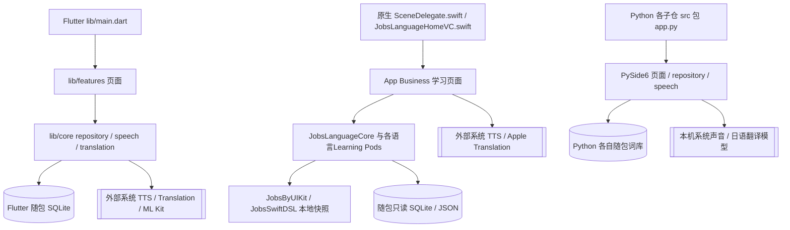
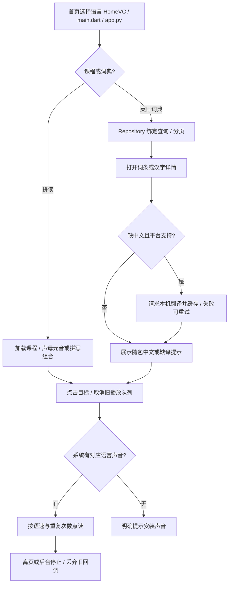
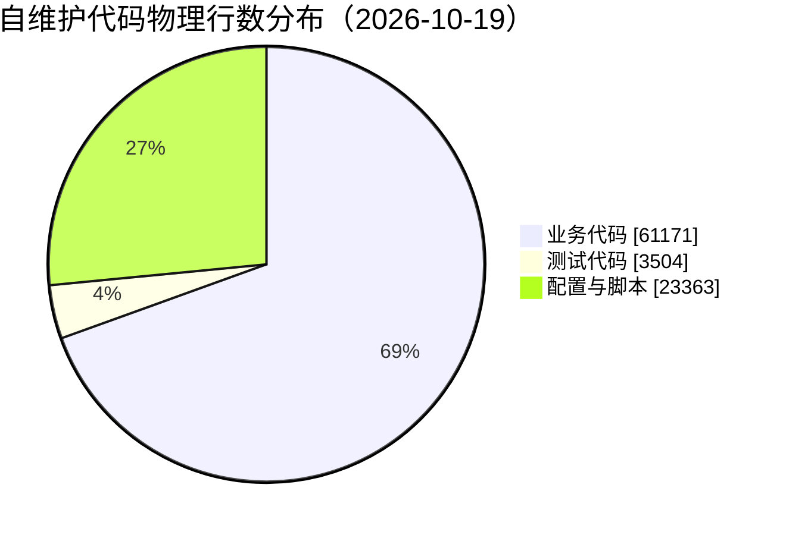

# JobsLanguageLearning · Jobs语言学习


<!-- jobs-toc:start -->
<!-- jobs-toc:source {"v":2,"token":"[toc]"} -->
<details>
<summary>📚 目录（点击展开 / 收起）</summary>

- [🔥 前言](#%E5%89%8D%E8%A8%80)
- [一、目录、版本与独立仓库边界](#structure)
- [二、工具链与提交历史](#environment-history)
  - [2.1、SDK、工具与锁文件](#versions)
  - [2.2、Git 历史](#history)
- [三、页面、路由与后端规模](#page-backend-statistics)
- [四、模块依赖与学习流程](#architecture)
- [五、功能清单与能力边界](#features)
- [六、代码规模与直接依赖](#dependencies)
  - [6.1、业务物理行数与占比](#source-statistics)
  - [6.2、原生直接 Pod 清单](#pod-dependencies)
  - [6.3、Flutter 直接依赖](#flutter-dependencies)
  - [6.4、Python 直接声明与许可](#python-dependencies)
  - [6.5、依赖与数据风险](#dependency-risks)
- [七、运行、构建、测试与配置](#run)
  - [7.1、原生 iOS](#native-run)
  - [7.2、Flutter](#flutter-run)
  - [7.3、Python 三工具](#python-run)
  - [7.4、常见问题与验证边界](#faq)
- [八、总仓内原生脚本入口概述](#scripts)
  - [【MacOS@Xcode】🫘打开终端运行Pod Install.command](#jobs-toc-heading-21)
  - [generate\_project.rb](#jobs-toc-heading-22)
  - [save\_device\_ipa\_after\_build.command](#jobs-toc-heading-23)

</details>
<!-- jobs-toc:end -->

---

## 🔥 <span id="前言">前言</span>

面向中文学习者的多语种离线词典与拼读工具总仓，提供 <u>[**Swift**](https://www.swift.org/)</u> 原生 iOS、[**Flutter**](https://flutter.dev/) 跨端应用及三个独立 [**Python**](https://www.python.org) 桌面工具。解决多语种检索、注音、系统语音点读与本机中文辅助翻译问题。**当前状态：在研／持续维护，尚有设备声音、翻译与发行授权验收；负责人：Jobs，未登记其它维护团队。**

总仓与 Python 子仓仅配置 [**GitHub**](https://github.com) 线路；Python 子仓保持独立历史，三端运行时各自使用已打包语料，不依赖来源工程所在目录。本文数字统一统计于 **2026-10-19（Asia/Shanghai）**；已执行验证与未覆盖边界分别以各版本记录为准。

## 一、<span id="structure">目录、版本与独立仓库边界</span> <a href="#前言" style="font-size:17px; color:green;"><b>🔼</b></a> <a href="#🔚" style="font-size:17px; color:green;"><b>🔽</b></a>


| 目录／文件 | 职责与状态 |
| --- | --- |
| [原生iOS版本](./原生iOS版本/README.md) | iPhone/iPad App、业务 UI、课程／Repository Pods、离线语料与测试；入口 `JobsLanguageLearning.xcworkspace` |
| [Flutter版本](./Flutter版本/README.md) | Android/iOS/macOS/Windows 宿主；入口 `lib/main.dart`；Web/Linux 未提供宿主 |
| [Python版本/JobsEnglishWordBook.py](./Python版本/JobsEnglishWordBook.py/README.md) | 分级英语词典独立子仓 |
| [Python版本/JobsKanjiByJap.py](./Python版本/JobsKanjiByJap.py/README.md) | 日语汉字点读与本机辅助翻译独立子仓 |
| [Python版本/JobsRussianTrainer.py](./Python版本/JobsRussianTrainer.py/README.md) | 多语拼读桌面工具独立子仓，沿用历史俄语工具仓名 |
| [.gitmodules](./.gitmodules) | 子模块路径、真实仓名与分支登记 |
| [.jobs-markdown-toc](./.jobs-markdown-toc/README.md) | 本地目录标签与远端折叠目录的受控转换工具 |

实际子模块配置节选；`path` 是本地目录，`url` 是仓名，不要求二者相同：

```gitconfig
[submodule "Python版本/JobsEnglishWordBook.py"]
    path = Python版本/JobsEnglishWordBook.py
    url = ../JobsEnglishWordBook.git
    branch = main
[submodule "Python版本/JobsKanjiByJap.py"]
    path = Python版本/JobsKanjiByJap.py
    url = ../JobsKanjiByJap.git
    branch = main
[submodule "Python版本/JobsRussianTrainer.py"]
    path = Python版本/JobsRussianTrainer.py
    url = ../JobsRussianTrainer.git
    branch = main
```

| 父仓真实 fetch 地址 | 相对子仓 URL | 解析结果 |
| --- | --- | --- |
| `git@github.com:JobsKits/JobsLanguageLearning.git` | `../JobsEnglishWordBook.git` | `git@github.com:JobsKits/JobsEnglishWordBook.git` |
| 同上 | `../JobsKanjiByJap.git` | `git@github.com:JobsKits/JobsKanjiByJap.git` |
| 同上 | `../JobsRussianTrainer.git` | `git@github.com:JobsKits/JobsRussianTrainer.git` |

以上为本地 Git URL 解析口径，未在线验证访问权限；新克隆需要相应仓库权限及 gitlink 指定提交可取得，不自动建立其它平台镜像。词库与原生演示视频采用 [**git-lfs**](https://git-lfs.com/)，克隆后须取得 LFS 实体内容，不能把指针文件当词库。

## 二、<span id="environment-history">工具链与提交历史</span> <a href="#前言" style="font-size:17px; color:green;"><b>🔼</b></a> <a href="#🔚" style="font-size:17px; color:green;"><b>🔽</b></a>


### 2.1、<span id="versions">SDK、工具与锁文件</span> <a href="#前言" style="font-size:17px; color:green;"><b>🔼</b></a> <a href="#🔚" style="font-size:17px; color:green;"><b>🔽</b></a>

| 类别 | 名称 | 版本／约束与依据 | 锁文件是否入库 |
| --- | --- | --- | --- |
| 原生语言 | Swift | 工程 `SWIFT_VERSION=5.0`，是语言模式；Xcode／实际编译器未固定 | — |
| 原生最低系统 | iOS/iPadOS | 原生 `Podfile`／工程为 `18.0` | — |
| 安装器 | [**CocoaPods**](https://cocoapods.org/) | 原生 `Podfile.lock` 记录 `1.17.0`；未见 Gemfile 工具锁 | 原生 `Podfile.lock` 已入库 |
| 跨端框架 | Flutter／[**Dart**](https://dart.dev) | 版本 README／生成元数据为 Flutter `3.47.6`；`pubspec.yaml` 要求 Dart `^3.13.5`，锁文件 sdk 下限 Flutter `3.44.0` | `Flutter版本/pubspec.lock` 已入库；未见 FVM 固定 |
| Android 构建 | [**Gradle**](https://gradle.org)／AGP／[**Kotlin**](https://kotlinlang.org) | wrapper `9.3.1`／settings `9.1.0`、`2.4.0`；Java/JVM target `17`；minSdk 继承当前 Flutter SDK 默认，仓内未写死数值 | wrapper 配置已入库 |
| Flutter 最低系统 | iOS／macOS／Windows | 版本说明 iOS `15.5`；macOS 工程 deployment `12.0`，按需 Translation 需 `15+`；Windows 具体系统基线未固定 | macOS `Podfile.lock` 已入库，iOS 无已跟踪 `Podfile.lock` |
| Python | Python／[**pip**](https://pip.pypa.io)／setuptools | 三个 pyproject：Python `>=3.11`，日语及拼读 `<3.15`；setuptools 英/日 `>=77`、拼读 `>=68`；pip 未固定 | 未发现 Python 依赖解析锁文件 |
| 系统 SDK | [**Xcode**](https://developer.apple.com/xcode)、Android SDK、Windows 工具链 | 需安装目标 SDK、签名或桌面开发工具；仓内未固定完整工具链版本 | — |

以上为项目声明与已留记录，未据当前机器工具版本改写工程要求，也未执行依赖安装。Flutter 平台插件不代表所有宿主均支持同一翻译能力。

### 2.2、<span id="history">Git 历史</span> <a href="#前言" style="font-size:17px; color:green;"><b>🔼</b></a> <a href="#🔚" style="font-size:17px; color:green;"><b>🔽</b></a>

以下均为本地可达 Git 历史；首次建库时间／托管平台创建时间均未知，不用首次提交冒充建库时间。首次／最近取 `git log --reverse`／`git log -1 --format='%aI %h'`；提交数取 `git rev-list --count HEAD`；贡献者取 `git shortlog -sn --all` 的非空作者行数，未另做身份合并。

| 工作树 | 首次提交 | 最近提交 | HEAD 提交数 | 贡献者 |
| --- | --- | --- | ---: | ---: |
| 总仓 | `2026-10-02T22:28:27+08:00 ec211eb` | `2026-10-18T23:41:34+08:00 c67b3c0` | 5 | 1（Jobs） |
| 英语子仓 | `2026-10-01T17:51:57+08:00 ae4169d` | `2026-10-18T23:40:24+08:00 06810b9` | 5 | 1（Jobs） |
| 日语子仓 | `2026-10-01T18:00:20+08:00 bb696de` | `2026-10-18T23:40:45+08:00 51f8227` | 6 | 1（Jobs） |
| 拼读子仓 | `2026-10-01T18:03:31+08:00 f618482` | `2026-10-18T23:41:07+08:00 892c13e` | 5 | 1（Jobs） |

各仓历史独立，不把父仓 gitlink 更新和子仓提交累加成单一开发活跃度。版本文档中“尚未创建 Git 提交或远端”属于创建阶段历史描述；当前以本表和 `.gitmodules` 为准。

## 三、<span id="page-backend-statistics">页面、路由与后端规模</span> <a href="#前言" style="font-size:17px; color:green;"><b>🔼</b></a> <a href="#🔚" style="font-size:17px; color:green;"><b>🔽</b></a>


页面按可导航组件／具体控制器类型去重，含下钻子页面，子页面是总数子集；不按语言参数、分页、主题、词条实例放大。弹层、半屏、对话框、主题菜单与导航容器不计；没有 H5／跨端容器需要单独加数。

| 端 | 页面数 | 其中子页面 | 路由数／交叉核对 | 依据 |
| --- | ---: | ---: | --- | --- |
| 原生 iOS | 11 | 6 | 命名路由 0；11 个具体目标类型含首页 | App 10 个具体 `...VC: JobsLanguageBaseVC`＋`JobsLanguageCore` 中 SettingsVC；不计 BaseVC。首页、俄语、通用拼读、英语、日语为 5 个主页面类型，两个选择器、英语详情、日语汉字／词语详情、设置为 6 个子页面 |
| Flutter Android/iOS/macOS/Windows | 每宿主共用 8 | 4 | 命名路由 0；8 个组件目标含首页，`MaterialPageRoute` 动态压栈 | `lib/main.dart` 的 HomePage，features 中 EnglishPage、EnglishDetail、JapanesePage、KanjiDetail、JapaneseWordDetail、PhoneticsPage、SettingsPage；语言参数复用 PhoneticsPage |
| Python 桌面 | 3 个主窗口组件 | 0 | 无 Web 命名路由；3 个 GUI 入口 | 三子仓 `src/*/app.py` 的 Window／TrainerWindow；英语栈式详情属于同一窗口，日语详情／设置为对话框，均按已声明规则不计独立组件 |
| Web／鸿蒙 | 0 | 0 | 0 | 未提供这些端的应用工程；Flutter 不包含 Web 宿主 |

原生首页的 8 个语言入口复用 4 类学习主页面，不等于 8 个控制器；Flutter 同样按组件类型计。具体实现见 [JobsLanguageHomeVC](./原生iOS版本/JobsLanguageLearning/JobsLanguageHomeVC/JobsLanguageHomeVC.swift)、[Flutter main.dart](./Flutter版本/lib/main.dart) 及各 features；不能与按每个语言实例计的项目横向比较。

| 协议 | 数量 | 依据 | 备注 |
| --- | ---: | --- | --- |
| HTTP | 0 | 三端入口、pyproject、pubspec、Podfile.deps | 未提供自建对外服务或 OpenAPI；系统翻译／词库下载不是本仓后端接口 |
| RPC | 0 | 同上 | 无对外服务注册 |
| MQ | 0 | 同上 | 无消费者配置 |

| 后端八项 | 结果与依据 |
| --- | --- |
| 对外接口 | HTTP/RPC/MQ 均 0，范围为当前受控三端应用源码 |
| 服务／部署单元 | 自建在线后端 0；移动／桌面 App 是客户端产物，不当后端服务计 |
| 核心数据表 | 后端 0；客户端英日只读 SQLite 不纳入后端主表口径 |
| 业务状态机 | 后端不适用；播放队列／界面生命周期是客户端状态 |
| 外部系统集成 | 后端不适用；客户端系统 TTS、Apple Translation／ML Kit、本机翻译模型详见功能表 |
| 定时／异步任务 | 后端定时 Job／批处理／MQ 消费者 0；UI 查询与语音异步不作服务 Job 计 |
| 中间件 | 后端未使用 Redis/MQ/搜索/对象存储；本地 SQLite 与系统偏好是客户端持久化 |
| QPS／日增／存储规模 | 无在线后端，QPS 不适用；设备缓存与语料占用未做统一运行测量，数值未知 |

页面与接口 1:2～1:5 的参考比值不适用于离线客户端总仓；不能据接口为 0 推断功能缺失。

## 四、<span id="architecture">模块依赖与学习流程</span> <a href="#前言" style="font-size:17px; color:green;"><b>🔼</b></a> <a href="#🔚" style="font-size:17px; color:green;"><b>🔽</b></a>


本总仓没有 `.codegraph/`，不主动初始化；以下依据当前入口、依赖清单与课程／Repository 源码整理。模块文件路径保留，外部系统服务与本机数据边界分开标明。





## 五、<span id="features">功能清单与能力边界</span> <a href="#前言" style="font-size:17px; color:green;"><b>🔼</b></a> <a href="#🔚" style="font-size:17px; color:green;"><b>🔽</b></a>


| 类目 | 是否涉及＋实现方式 | 证据与限制 |
| --- | --- | --- |
| 学习功能 | 是：英语分级词本、日语汉字／词语／例句、俄法西朝鲜德阿拉伯语拼读 | 原生 `Business`＋各 Learning Pod、Flutter `features`／`core/phonetics.dart`、Python 拼读子仓课程；三端能力以各 README 为准，不承诺逐项完全一致 |
| 网络与安全 | 部分：主体离线；系统翻译首次下载包；来源资源保留校验 | `resource-provenance.json`、Flutter `core/translation.dart`；未提供自有 API 加解密、SSL Pinning、OAuth/JWT/Session 登录或专用密钥存储，不能把系统通道视为认证系统 |
| 持久化／数据库 | 是：英日只读 SQLite、本机偏好、已生成中文缓存 | 原生 Repository actor、`JobsKanjiChinese.json`；Flutter `core/repository.dart` 的 `catalog-v1` 与 settings；SQLite 随系统／平台插件，实际引擎版本未固定 |
| 缓存／升级 | 是：打包词库复制到本机目录，参数绑定与请求序号过滤；翻译缓存 | Flutter 资源更新需提升 catalog 目录版本；原生只读语料和本机设置分别管理；未提供服务端数据迁移 |
| 端能力 | 部分：系统语音、Windows 本机声音、按需中文翻译 | 未确认蓝牙／推送／定位／相机／生物识别／扫码／NFC／分享／支付业务；URL launcher 用于来源链接，不是社交分享集成 |
| 多语言／主题 | 部分：多语学习内容与注音；中文界面；白天／黑夜／跟随系统持久化 | HomeVC、Flutter main/settings、Python主题配置；学习语种不等于 App 全界面国际化 |
| 工程能力 | 部分：单元与 UI／集成测试、依赖及语料快照、原生自动 IPA 输出 | 未确认统一埋点平台、崩溃收集、热更新或 CI/CD；`Tests`／`test`／`integration_test` 和各验证记录是实际边界 |
| 后端治理 | 不涉及：无自建后端 | 幂等、限流熔断、分布式锁、服务事务、链路追踪、灰度、支付对账均不适用；播放取消不作服务幂等计 |
| 合规／隐私 | 部分：NOTICE、语料来源、原句作者链接与本机缓存说明 | 未完成全部商业发行／隐私清单验收；英语原词书无明确再分发授权，日语派生数据有 CC BY-SA 义务；设备语言包需运行者允许下载 |

系统 TTS 不等于专业音素录音；自动中文与振假名未全量人工校对。Python 已有历史 `.app`／`.dmg` 不保证覆盖新增语种；真机声音、翻译语言包、Windows 构建与页面视觉以实际版本验证记录为准。

## 六、<span id="dependencies">代码规模与直接依赖</span> <a href="#前言" style="font-size:17px; color:green;"><b>🔼</b></a> <a href="#🔚" style="font-size:17px; color:green;"><b>🔽</b></a>


### 6.1、<span id="source-statistics">业务物理行数与占比</span> <a href="#前言" style="font-size:17px; color:green;"><b>🔼</b></a> <a href="#🔚" style="font-size:17px; color:green;"><b>🔽</b></a>

统计日期 2026-10-19。先取总仓 `git ls-files -z`，再显式进入 `.gitmodules` 的 3 个已检出 Python 独立工作树分别取清单，按绝对文件路径去重；gitlink 目录自身不当源码，不以父仓清单遗漏 Python。读当前受控工作区文本，包含 Jobs 自维护通用 Pod 快照，未跟踪文件不计。资源、第三方、`ManualBy*Pods@Pods`、`ThirdParty`、Pods、缓存／构建／产物、生成文件、文档、锁文件排除；`Tests`／`test`／`integration_test` 和脚本测试独立列，Podfile／podspec／工程设置／脚本归配置。

| 类别 | 文件数 | 物理行数 | 行数占比 |
| --- | ---: | ---: | ---: |
| 业务代码 | 443 | 61,171 | 69.48% |
| 测试代码 | 20 | 3,504 | 3.98% |
| 配置与脚本 | 159 | 23,363 | 26.54% |
| 第三方依赖/工具链（排除） | 289 | 38,607 | 不进分母 |
| 生成代码（排除） | 4 | 76 | 不进分母 |
| 资源/文档/锁文件等（排除） | 658 | 73,357 | 不进分母 |
| 其它文件（排除） | 101 | 6,022 | 不进分母 |

分母为业务、测试、配置与脚本的 88,038 行；UTF-8 文本按 `splitlines()` 统计，含空行与注释，属于物理行数，非工具剔除注释后的 SLOC。二进制／无法按 UTF-8 解码的排除文件只记文件数，行数记 0。



### 6.2、<span id="pod-dependencies">原生直接 Pod 清单</span> <a href="#前言" style="font-size:17px; color:green;"><b>🔼</b></a> <a href="#🔚" style="font-size:17px; color:green;"><b>🔽</b></a>

以 [Podfile.deps](./原生iOS版本/Podfile.deps) 和 [Podfile.lock](./原生iOS版本/Podfile.lock) 为依据，2026-10-19 共有 28 个直接声明：27 个 Jobs 本地 Pod＋1 个 lottie-ios 本地第三方快照。只数直接声明，SnapKit／导航等传递依赖不重复计。下表“已使用”表示声明进入构建依赖图，未逐个证明每项均有运行调用；未设置私有远程库，不编造私库地址。

| 依赖名 | 版本 | 来源（公库／私库） | 私库地址 | 许可证 | 直接／传递 | 用途模块 | 是否仍使用 |
| --- | --- | --- | --- | --- | --- | --- | --- |
| [lottie-ios](./原生iOS版本/JobsByPods/ManualBySwiftPods@Pods/lottie-ios) | 4.6.0 | 本仓本地源码；非私服 | — | Apache-2.0（随库 LICENSE） | 直接 | 动画库；仅确认声明，未确认业务调用 | 已声明/构建图使用；运行时逐库待核 |
| [JobsLanguageCore](./原生iOS版本/JobsByPods/JobsLanguageCore@Pods) | 1.0.0 | 本仓本地源码；非私服 | — | MIT（podspec 声明；资源另计） | 直接 | 课程/词库/点读基座 | 已声明/构建图使用；运行时逐库待核 |
| [JobsRussianLearning](./原生iOS版本/JobsByPods/JobsRussianLearning@Pods) | 1.0.0 | 本仓本地源码；非私服 | — | MIT（podspec 声明；资源另计） | 直接 | 课程/词库/点读基座 | 已声明/构建图使用；运行时逐库待核 |
| [JobsFrenchLearning](./原生iOS版本/JobsByPods/JobsFrenchLearning@Pods) | 1.0.0 | 本仓本地源码；非私服 | — | MIT（podspec 声明；资源另计） | 直接 | 课程/词库/点读基座 | 已声明/构建图使用；运行时逐库待核 |
| [JobsSpanishLearning](./原生iOS版本/JobsByPods/JobsSpanishLearning@Pods) | 1.0.0 | 本仓本地源码；非私服 | — | MIT（podspec 声明；资源另计） | 直接 | 课程/词库/点读基座 | 已声明/构建图使用；运行时逐库待核 |
| [JobsKoreanLearning](./原生iOS版本/JobsByPods/JobsKoreanLearning@Pods) | 1.0.0 | 本仓本地源码；非私服 | — | MIT（podspec 声明；资源另计） | 直接 | 课程/词库/点读基座 | 已声明/构建图使用；运行时逐库待核 |
| [JobsGermanLearning](./原生iOS版本/JobsByPods/JobsGermanLearning@Pods) | 1.0.0 | 本仓本地源码；非私服 | — | MIT（podspec 声明；资源另计） | 直接 | 课程/词库/点读基座 | 已声明/构建图使用；运行时逐库待核 |
| [JobsEnglishLearning](./原生iOS版本/JobsByPods/JobsEnglishLearning@Pods) | 1.0.0 | 本仓本地源码；非私服 | — | MIT（podspec 声明；资源另计） | 直接 | 课程/词库/点读基座 | 已声明/构建图使用；运行时逐库待核 |
| [JobsKanjiLearning](./原生iOS版本/JobsByPods/JobsKanjiLearning@Pods) | 1.0.0 | 本仓本地源码；非私服 | — | MIT（podspec 声明；资源另计） | 直接 | 课程/词库/点读基座 | 已声明/构建图使用；运行时逐库待核 |
| [JobsByUIKit](./原生iOS版本/JobsByPods/JobsByUIKit@Pods) | 0.0.1 | 本仓本地源码；非私服 | — | MIT（podspec 声明；资源另计） | 直接 | Jobs UI/基础能力快照 | 已声明/构建图使用；运行时逐库待核 |
| [JobsSwiftDSL](./原生iOS版本/JobsByPods/JobsSwiftDSL@Pods) | 0.1.0 | 本仓本地源码；非私服 | — | MIT（podspec 声明；资源另计） | 直接 | Jobs UI/基础能力快照 | 已声明/构建图使用；运行时逐库待核 |
| [JobsInheritance](./原生iOS版本/JobsByPods/JobsInheritance@Pods) | 0.0.1 | 本仓本地源码；非私服 | — | MIT（podspec 声明；资源另计） | 直接 | Jobs UI/基础能力快照 | 已声明/构建图使用；运行时逐库待核 |
| [Jobsl10n](./原生iOS版本/JobsByPods/Jobsl10n@Pods) | 0.1.14 | 本仓本地源码；非私服 | — | MIT（podspec 声明；资源另计） | 直接 | Jobs UI/基础能力快照 | 已声明/构建图使用；运行时逐库待核 |
| [JobsScale](./原生iOS版本/JobsByPods/JobsScale@Pods) | 0.1.14 | 本仓本地源码；非私服 | — | MIT（podspec 声明；资源另计） | 直接 | Jobs UI/基础能力快照 | 已声明/构建图使用；运行时逐库待核 |
| [JobsGetWindow](./原生iOS版本/JobsByPods/JobsGetWindow@Pods) | 0.1.14 | 本仓本地源码；非私服 | — | MIT（podspec 声明；资源另计） | 直接 | Jobs UI/基础能力快照 | 已声明/构建图使用；运行时逐库待核 |
| [JobsNavBar](./原生iOS版本/JobsByPods/JobsNavBar@Pods) | 0.1.14 | 本仓本地源码；非私服 | — | MIT（podspec 声明；资源另计） | 直接 | Jobs UI/基础能力快照 | 已声明/构建图使用；运行时逐库待核 |
| [JobsSwiftBlock](./原生iOS版本/JobsByPods/JobsSwiftBlock@Pods) | 0.1.0 | 本仓本地源码；非私服 | — | MIT（podspec 声明；资源另计） | 直接 | Jobs UI/基础能力快照 | 已声明/构建图使用；运行时逐库待核 |
| [JobsSwiftBaseDefines](./原生iOS版本/JobsByPods/JobsSwiftBaseDefines@Pods) | 0.1.6 | 本仓本地源码；非私服 | — | MIT（podspec 声明；资源另计） | 直接 | Jobs UI/基础能力快照 | 已声明/构建图使用；运行时逐库待核 |
| [JobsTextTools](./原生iOS版本/JobsByPods/JobsTextTools@Pods) | 0.1.14 | 本仓本地源码；非私服 | — | MIT（podspec 声明；资源另计） | 直接 | Jobs UI/基础能力快照 | 已声明/构建图使用；运行时逐库待核 |
| [JobsSwiftTimer](./原生iOS版本/JobsByPods/JobsSwiftTimer@Pods) | 0.1.0 | 本仓本地源码；非私服 | — | MIT（podspec 声明；资源另计） | 直接 | Jobs UI/基础能力快照 | 已声明/构建图使用；运行时逐库待核 |
| [JobsImageTools](./原生iOS版本/JobsByPods/JobsImageTools@Pods) | 0.1.14 | 本仓本地源码；非私服 | — | MIT（podspec 声明；资源另计） | 直接 | Jobs UI/基础能力快照 | 已声明/构建图使用；运行时逐库待核 |
| [JobsByQuartzCore](./原生iOS版本/JobsByPods/JobsByQuartzCore@Pods) | 0.0.1 | 本仓本地源码；非私服 | — | MIT（podspec 声明；资源另计） | 直接 | Jobs UI/基础能力快照 | 已声明/构建图使用；运行时逐库待核 |
| [JobsViewPush](./原生iOS版本/JobsByPods/JobsViewPush@Pods) | 0.0.1 | 本仓本地源码；非私服 | — | MIT（podspec 声明；资源另计） | 直接 | Jobs UI/基础能力快照 | 已声明/构建图使用；运行时逐库待核 |
| [JobsToast](./原生iOS版本/JobsByPods/JobsToast@Pods) | 0.1.14 | 本仓本地源码；非私服 | — | MIT（podspec 声明；资源另计） | 直接 | Jobs UI/基础能力快照 | 已声明/构建图使用；运行时逐库待核 |
| [JobsByWebKit](./原生iOS版本/JobsByPods/JobsByWebKit@Pods) | 0.0.1 | 本仓本地源码；非私服 | — | MIT（podspec 声明；资源另计） | 直接 | Jobs UI/基础能力快照 | 已声明/构建图使用；运行时逐库待核 |
| [JobsSwiftDebugTools](./原生iOS版本/JobsByPods/JobsSwiftDebugTools@Pods) | 0.0.1 | 本仓本地源码；非私服 | — | MIT（podspec 声明；资源另计） | 直接 | Jobs UI/基础能力快照 | 已声明/构建图使用；运行时逐库待核 |
| [JobsSwiftFoundation](./原生iOS版本/JobsByPods/JobsSwiftFoundation@Pods) | 0.1.1 | 本仓本地源码；非私服 | — | MIT（podspec 声明；资源另计） | 直接 | Jobs UI/基础能力快照 | 已声明/构建图使用；运行时逐库待核 |
| [JobsSwiftStandardLibrary](./原生iOS版本/JobsByPods/JobsSwiftStandardLibrary@Pods) | 0.0.1 | 本仓本地源码；非私服 | — | MIT（podspec 声明；资源另计） | 直接 | Jobs UI/基础能力快照 | 已声明/构建图使用；运行时逐库待核 |

MIT 是 Pod 源码声明，不替代其中词库的独立许可。lottie-ios 仅确认安装声明，业务调用待核，清理前须验证工程依赖。path Pod 版本号不冻结文件内容，快照受本仓提交／`dependency-snapshot.json` 约束。

### 6.3、<span id="flutter-dependencies">Flutter 直接依赖</span> <a href="#前言" style="font-size:17px; color:green;"><b>🔼</b></a> <a href="#🔚" style="font-size:17px; color:green;"><b>🔽</b></a>

2026-10-19 依据 [pubspec.yaml](./Flutter版本/pubspec.yaml) 与 [pubspec.lock](./Flutter版本/pubspec.lock) 计 11 个直接声明（含 3 个 SDK 包与开发检查工具）；插件许可证从当前本机已解析包的 LICENSE 核对，首次在其它机器恢复仍应核查随包许可。

| 依赖名 | 版本（声明 → 锁定） | 来源／私库地址 | 许可证 | 关系 | 用途／仍使用 |
| --- | --- | --- | --- | --- | --- |
| flutter | SDK／3.47.6 记录基线 | Flutter SDK；— | BSD-3-Clause | 直接 | App框架，是 |
| flutter_test | SDK | Flutter SDK；— | BSD-3-Clause | 直接开发 | 单元／组件测试，是 |
| integration_test | SDK | Flutter SDK；— | BSD-3-Clause | 直接开发 | 集成测试，是 |
| [**flutter_tts**](https://pub.dev/packages/flutter_tts) | ^4.2.5 → 4.2.5 | pub.dev 公库；— | MIT | 直接 | 系统点读，是 |
| [**shared_preferences**](https://pub.dev/packages/shared_preferences) | ^2.5.5 → 2.5.5 | pub.dev 公库；— | BSD-3-Clause | 直接 | 主题／语音偏好，是 |
| [**path_provider**](https://pub.dev/packages/path_provider) | ^2.1.6 → 2.1.6 | pub.dev 公库；— | BSD-3-Clause | 直接 | 本机目录，是 |
| [**sqflite**](https://pub.dev/packages/sqflite) | ^2.4.4 → 2.4.4 | pub.dev 公库；— | BSD-2-Clause | 直接 | SQLite，是 |
| [**sqflite_common_ffi**](https://pub.dev/packages/sqflite_common_ffi) | ^2.4.3 → 2.4.3 | pub.dev 公库；— | BSD-2-Clause | 直接 | 桌面SQLite，是 |
| [**url_launcher**](https://pub.dev/packages/url_launcher) | ^6.3.2 → 6.3.2 | pub.dev 公库；— | BSD-3-Clause | 直接 | 来源／作者链接，是 |
| [**google_mlkit_translation**](https://pub.dev/packages/google_mlkit_translation) | ^0.15.1 → 0.15.1 | pub.dev 公库；— | MIT（插件代码；原生SDK条款另核） | 直接 | 移动端按需翻译，是 |
| [**flutter_lints**](https://pub.dev/packages/flutter_lints) | ^6.0.0 → 6.0.0 | pub.dev 公库；— | BSD-3-Clause | 直接开发 | 静态检查，是 |

### 6.4、<span id="python-dependencies">Python 直接声明与许可</span> <a href="#前言" style="font-size:17px; color:green;"><b>🔼</b></a> <a href="#🔚" style="font-size:17px; color:green;"><b>🔽</b></a>

2026-10-19 以三个 pyproject.toml 的 runtime／optional／build-system 声明为依据，跨子仓按包名去重为 9 项；同包在不同项目的约束合并显示，不把可选构建／语料工具说成启动必需。均为 PyPI 公库，私库地址为“—”，许可证依据各子仓 NOTICE／现有说明；未有随包证据的明确待核实。

| 依赖名 | 声明约束 | 许可证 | 关系 | 用途模块／是否仍使用 |
| --- | --- | --- | --- | --- |
| [**PySide6**](https://doc.qt.io/qtforpython-6/) | 英／日 ==6.11.2；拼读 >=6.8,<7 | LGPL-3.0／GPL-3.0／商业许可，按所用模块；须核发行义务 | 直接运行 | 三工具 GUI／声音，是 |
| [**CTranslate2**](https://github.com/OpenNMT/CTranslate2) | 日语 ==4.8.2 | MIT（NOTICE） | 直接运行 | 日语本机翻译，是 |
| [**SentencePiece**](https://github.com/google/sentencepiece) | 日语 ==0.2.2 | Apache-2.0（NOTICE） | 直接运行 | 日语翻译分词，是 |
| [**setuptools**](https://setuptools.pypa.io/) | 英／日 >=77；拼读 >=68 | 待核实 | 直接构建 | 三工具安装构建，是 |
| [**PyInstaller**](https://pyinstaller.org/) | 英／日 ==6.22.3；拼读 >=6.16,<7 | GPL，含 bootloader 分发例外（NOTICE）；核对具体发行包 | 直接可选构建 | App/DMG/EXE打包入口使用 |
| [**pytest**](https://docs.pytest.org/) | 英语 >=8,<10 | 待核实 | 直接可选测试 | 英语测试声明，测试入口使用 |
| [**wordfreq**](https://github.com/rspeer/wordfreq) | 英语 ==3.1.1 | 代码 Apache-2.0，数据 CC BY-SA 4.0（NOTICE） | 直接可选语料 | 英语词频／分级；运行不必安装 |
| [**SudachiPy**](https://github.com/WorksApplications/SudachiPy) | 日语 ==0.7.0 | Apache-2.0（NOTICE） | 直接可选语料 | 日语预处理；运行不必安装 |
| [**SudachiDict-core**](https://github.com/WorksApplications/SudachiDict) | 日语 ==20260723.1 | Apache-2.0＋词典第三方条款（NOTICE） | 直接可选语料 | 日语预处理；运行不必安装 |

### 6.5、<span id="dependency-risks">依赖与数据风险</span> <a href="#前言" style="font-size:17px; color:green;"><b>🔼</b></a> <a href="#🔚" style="font-size:17px; color:green;"><b>🔽</b></a>

- PySide6/Qt 与 PyInstaller 涉及 LGPL/GPL／例外或商业许可，发行前按实际模块和打包形式核对、随包保留条款；不能将 GPL 字样直接等同无条件禁止商用，也不能忽略分发义务。
- 英语 kajweb/dict 原词书未提供明确再分发授权；原生、Flutter、Python 复制数据均不扩大许可。日语 KANJIDIC2/JMdict 的 CC BY-SA 4.0、Tatoeba 归属和翻译模型许可独立保留。详情见各版本 `Resource`／`assets` 的 NOTICE 与 provenance。
- Flutter 的 `^`、Python 的范围依赖／setuptools 下限及原生 path Pod 都存在浮动；Flutter 锁文件约束当前解析，Python 无统一锁。恢复时保留已有锁，不以最新解析冒充已验证版本。
- 当前未在线审计依赖归档／停止维护与漏洞库，状态均待核实，不声称“无已知漏洞”。表中待核许可证在发行前补齐；开发测试通过不能替代发行合规核对。

## 七、<span id="run">运行、构建、测试与配置</span> <a href="#前言" style="font-size:17px; color:green;"><b>🔼</b></a> <a href="#🔚" style="font-size:17px; color:green;"><b>🔽</b></a>


以下命令是接手入口，需在各自目录执行，不在总仓混跑；安装会联网并写依赖环境，原生构建可触发 IPA 输出阶段。三端没有统一 dev/test/prod 服务器配置，主体离线；签名／目标设备／系统模型按平台配置。英语与日语首次查询必须有真实 LFS 词库，而非指针。

### 7.1、<span id="native-run">原生 iOS</span> <a href="#前言" style="font-size:17px; color:green;"><b>🔼</b></a> <a href="#🔚" style="font-size:17px; color:green;"><b>🔽</b></a>

准备 macOS、iOS 18+ SDK、CocoaPods；真机用自己的 Team。工程已存在时直接开 workspace，依赖缺失时才安装：

```sh
cd './原生iOS版本'
pod install --no-repo-update
open JobsLanguageLearning.xcworkspace
xcodebuild   -workspace JobsLanguageLearning.xcworkspace   -scheme JobsLanguageLearning   -destination 'generic/platform=iOS Simulator'   CODE_SIGNING_ALLOWED=NO   build
```

XCTest 使用同一 workspace/scheme，把 destination 换成当前机器存在的 iOS 18+ 模拟器并将 `build` 改 `test`。Debug/Release 配置在 `.xcodeproj/project.pbxproj` 与 Podfile；主 App 的 Save Build IPA 会在成功压缩后清空该版本 `build/` 并保留本次唯一产物，模拟器 IPA 不能当真机包。语音和 Translation 首次下载必须实机确认；模拟器编译不证明听音和翻译通过。

### 7.2、<span id="flutter-run">Flutter</span> <a href="#前言" style="font-size:17px; color:green;"><b>🔼</b></a> <a href="#🔚" style="font-size:17px; color:green;"><b>🔽</b></a>

准备对应目标平台工具链；本机 macOS 示例：

```sh
cd './Flutter版本'
flutter pub get
flutter run -d macos
flutter build macos --release
flutter analyze
flutter test
flutter test integration_test/app_test.dart -d macos
```

其它目标用各平台设备及 build 命令；Windows 在 Windows 主机构建，Android release 当前仍使用模板 debug 签名，正式发布前需替换。Android `build.gradle.kts`、iOS/macOS Runner 工程负责平台配置；本机偏好与 `catalog-v1` 目录缓存独立。Windows 缺译保留内置中文及提示，不宣称已经接入设备翻译。

### 7.3、<span id="python-run">Python 三工具</span> <a href="#前言" style="font-size:17px; color:green;"><b>🔼</b></a> <a href="#🔚" style="font-size:17px; color:green;"><b>🔽</b></a>

进入所选子仓内层工程，使用满足约束的 Python 独立虚拟环境；日语及拼读不要使用 Python 3.15。以英语为例：

```sh
cd './Python版本/JobsEnglishWordBook.py/JobsEnglishWordBook'
python3 -m venv .venv
.venv/bin/python -m pip install -e '.[test]'
.venv/bin/jobs-english-wordbook
.venv/bin/python -m pytest
```

日语 GUI 入口为 `jobs-kanji-by-jap`，拼读为 `jobs-russian-trainer`，安装后从同一虚拟环境调用，分别见各 pyproject；Windows 用虚拟环境 `Scripts/python.exe`。日语翻译模型须按子仓 README／manifest 的地址与 SHA-256 恢复，不把未经校验的新模型替换已验数据。GUI、DMG/EXE 构建与清旧产物边界均以各独立仓 README 的实际入口为准，父仓不重复展开所有子仓脚本。

### 7.4、<span id="faq">常见问题与验证边界</span> <a href="#前言" style="font-size:17px; color:green;"><b>🔼</b></a> <a href="#🔚" style="font-size:17px; color:green;"><b>🔽</b></a>

| 现象 | 排查与处理 |
| --- | --- |
| 子仓空目录 | 按 `.gitmodules` 恢复对应 gitlink，确认访问权限；不把空目录计为源码已取得 |
| 词库无法打开／只有文本指针 | 确认 git-lfs 实体和 provenance 校验，保留原来源归属 |
| 原生找不到模块 | 打开 workspace，按 Podfile.deps 恢复依赖；不要改第三方源码或删除锁文件碰碰运气 |
| Python Qt 安装失败 | 核对 Python 上限、系统架构与现有依赖约束，避免污染系统 Python |
| 无声音 | 安装对应语种系统声音、检查输出／音量；不跨语种兜底 |
| 日语中文缺译／翻译失败 | 检查支持平台、语言包／模型与缓存；保留明确缺译提示，不生成未校对的占位释义 |
| 跨端功能或主题不一致 | 对照同一语言和设置流程同步复核 iOS／Flutter；Python 界面依其独立工具边界 |

实际检查记录在[原生验证记录](./原生iOS版本/验证记录.md)、[Flutter验证记录](./Flutter版本/验证记录.md)及三个 Python README／验证结果中。本文仅执行文档、路径、源码与统计静态复核，未重新安装依赖、运行 GUI、编译、测试或执行打包；历史通过不代表所有当前平台均已验收。统计或依赖变化时更新口径、日期、表格与两张流程图，超过一个迭代周期重新取数。

## 八、<span id="scripts">总仓内原生脚本入口概述</span> <a href="#前言" style="font-size:17px; color:green;"><b>🔼</b></a> <a href="#🔚" style="font-size:17px; color:green;"><b>🔽</b></a>


本章只概述总仓维护的原生工程操作入口；Pod 快照内的旧发布入口不由 App 自动执行，Python 独立子仓脚本在各自 README 管理。CocoaPods 网络适配与选源模块仅由 Podfile 加载，在本次安装进程范围准备网络，不按独立业务入口计。

### <span id="jobs-toc-heading-21" data-jobs-toc="v2">[【MacOS@Xcode】🫘打开终端运行Pod Install.command](./原生iOS版本/ScriptsByPods/【MacOS@Xcode】🫘打开终端运行Pod%20Install.command/【MacOS@Xcode】🫘打开终端运行Pod%20Install.command)</span><!-- jobs-toc:heading-end -->

> **目的：** 从 Xcode Behaviors 或双击脚本进入手动依赖安装。

- 显示工程路径，回车确认后检查 Podfile 与已有 CocoaPods，`Ctrl+C` 取消。
- 执行原 Podfile 安装流程，可能联网、更新 Pods/锁文件并执行既有 hook；不自动构建。
- 返回真实退出码，日志为系统临时目录中的 `language-learning-pod-install.log`；换机需重新配置 Behaviors。

### <span id="jobs-toc-heading-22" data-jobs-toc="v2">[generate_project.rb](./原生iOS版本/ScriptsByDevTools/generate_project.rb)</span><!-- jobs-toc:heading-end -->

> **目的：** 初始生成原生 App、测试、共享 Scheme 与构建阶段。

- 检查已有 `.xcodeproj`，已存在即停止，避免覆盖现有工程。
- 使用 xcodeproj gem 创建工程，挂载手动安装展示引用与 Save Build IPA。
- 输出工程路径，不安装依赖、不执行编译；已有工程日常在 Xcode 维护。

### <span id="jobs-toc-heading-23" data-jobs-toc="v2">[save_device_ipa_after_build.command](./原生iOS版本/ScriptsByDevTools/save_device_ipa_after_build.command/save_device_ipa_after_build.command)</span><!-- jobs-toc:heading-end -->

> **目的：** 将本次真机或模拟器 App 输出为唯一 IPA 快照。

- 读取本次构建环境，在临时目录压缩；真机核对签名。
- 成功后清空本版本 `build/`，写入唯一 `真机.ipa` 或 `模拟器.ipa`；失败保留旧产物。
- Xcode 主 App 构建阶段自动执行；独立终端需回车及精确 `YES` 确认清理，日志见系统临时目录中的 `save_device_ipa_after_build.log`。

<a id="🔚" href="#前言" style="font-size:17px; color:green; font-weight:bold;">我是有底线的➤点我回到首页</a>
